# AlertEye — Real-time Image & Sensors based Driver Drowsiness Detection using Deep Learning

AlertEye is a Flutter mobile app that watches for signs of driver fatigue and risky driving in real time. It combines **camera-based eye-state detection** (MobileNetV2) with **phone motion-sensor analysis** (ConvLSTM2D on accelerometer and gyroscope data). When the driver's eyes stay closed, the app raises an on-screen alert and plays an alarm.

This is our Bachelor's Final Year Project (FYP) at the Department of Computer Science, National University of Computer and Emerging Sciences (FAST-NUCES), Peshawar, Pakistan, session 2020–2024.

## Team

| Name | Roll No. | Role |
|---|---|---|
| Saad Rahman | 20P-0027 | Developer |
| Aimal Khan | 20P-0028 | Developer |

**Supervisor:** [Dr. Hafeez Anwar](https://pwr.nu.edu.pk/faculty-profile/?id=6833), Professor, Department of Computer Science, FAST-NUCES Peshawar
- PhD in Informatics, Vienna University of Technology, Austria (2015); MS in Mechanical Engineering, Myongji University, South Korea (2011); BS in Computer Science and Engineering, UET Peshawar (2008)
- Research interests: computer vision and deep learning (solar-panel dust detection, image-based recognition, satellite imagery, AIoT for healthcare and emotion recognition)
- [Google Scholar](https://scholar.google.com/citations?user=5zKe6mUAAAAJ&hl=en) · hafeez.anwar@nu.edu.pk

## Features

- **Eye-state detection:** the camera feed is analysed frame by frame. Google ML Kit locates the face and eyes, and a MobileNetV2 classifier labels each eye as open or closed.
- **Drowsiness alert:** if the eyes are closed in more than half of the frames in a batch, AlertEye shows an alert dialog and loops an alarm sound until the driver dismisses it.
- **Driving-behavior sensing:** accelerometer and gyroscope data are streamed from the phone to a server, which logs them. A ConvLSTM2D model classifies Normal vs Aggressive driving.
- **Driver-facing screens:** splash, sign-up, login, forgot password, home, trip/camera, emergency contacts, profile, settings and safety rules.

## Screenshots

UI designs from the project report (Chapter 5). They show the intended look of the app.

| Splash | Sign up | Login | Forgot password |
|:---:|:---:|:---:|:---:|
| 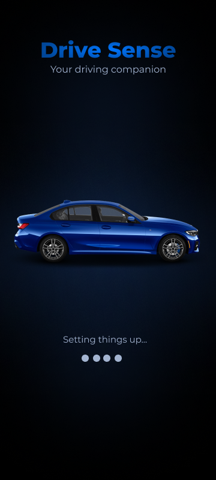 | 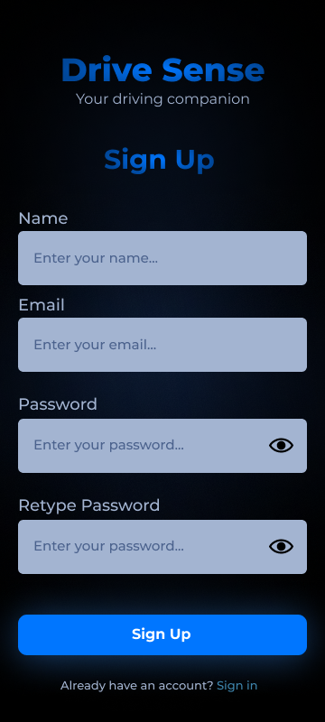 | 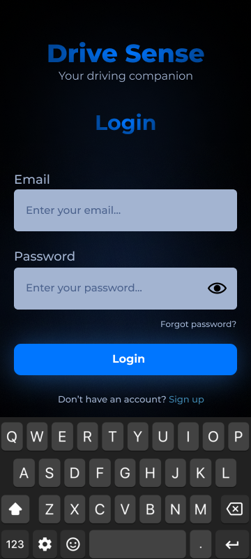 | 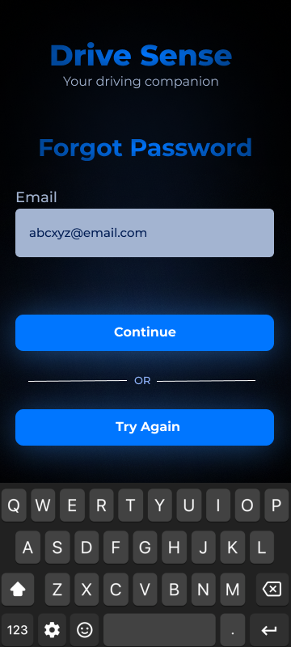 |

| Home | Emergency contacts | Start trip | Drowsiness alert |
|:---:|:---:|:---:|:---:|
| 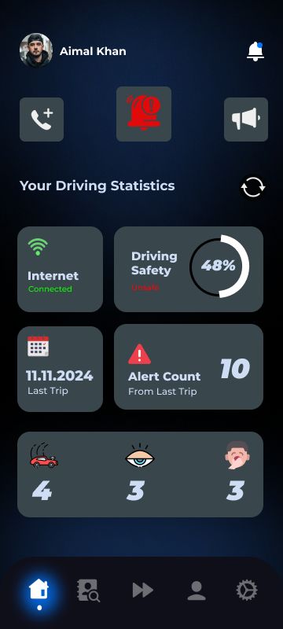 | 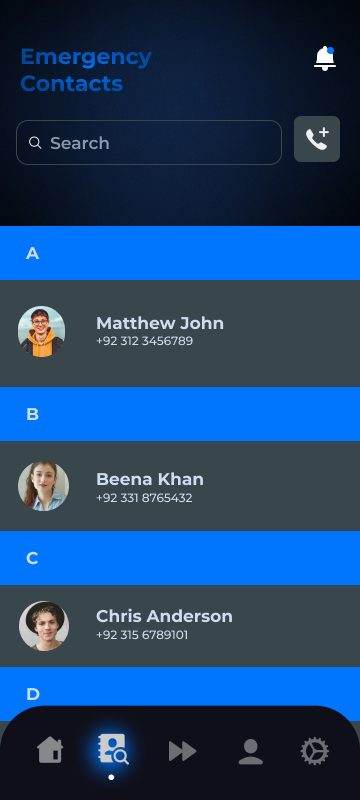 | 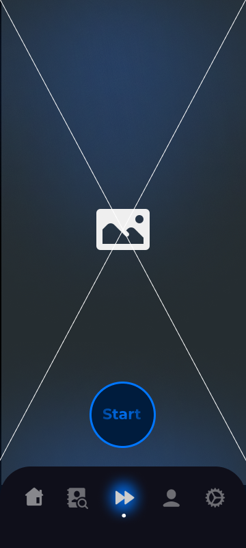 | 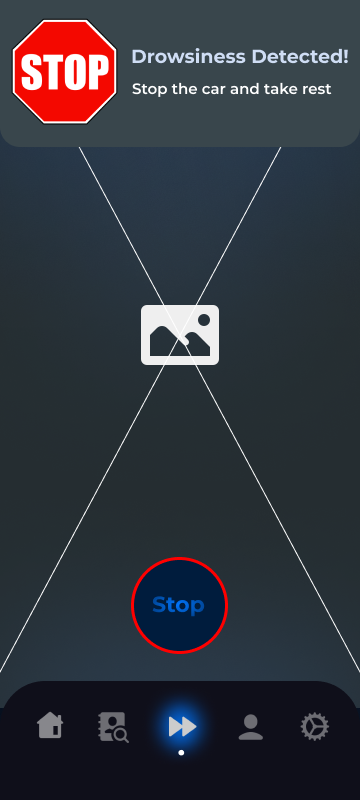 |

| Account | Settings |
|:---:|:---:|
| 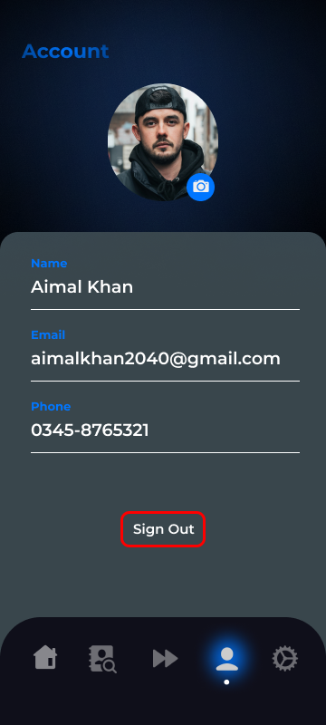 | 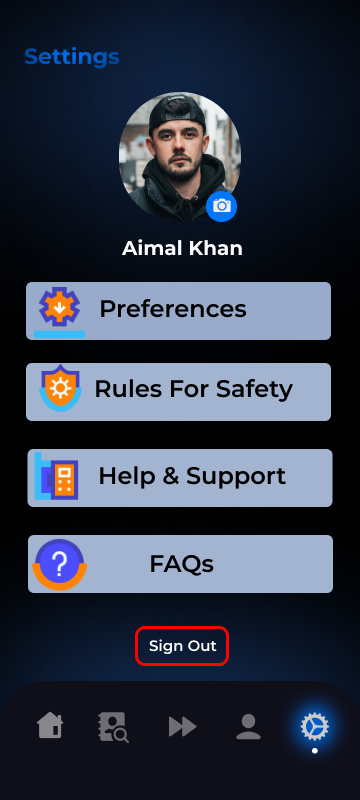 |

## System Architecture

### On the phone (AlertEye app)

<p align="center">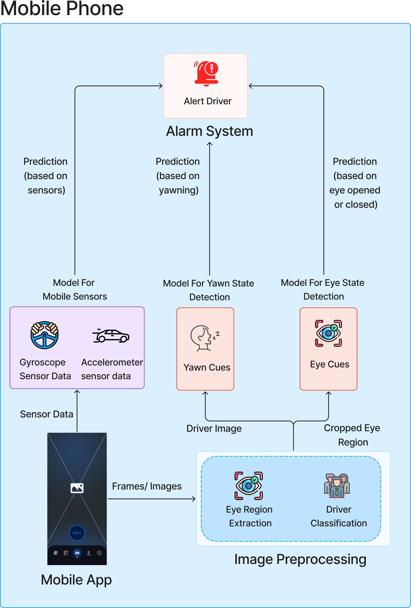</p>

The app sends camera frames through image preprocessing (eye-region extraction and driver classification). The cropped eyes go to the eye-state model and the driver image goes to the yawn model. Gyroscope and accelerometer data go to the sensor model. Every prediction feeds the alarm system, which alerts the driver.

### Model development (computer)

<p align="center">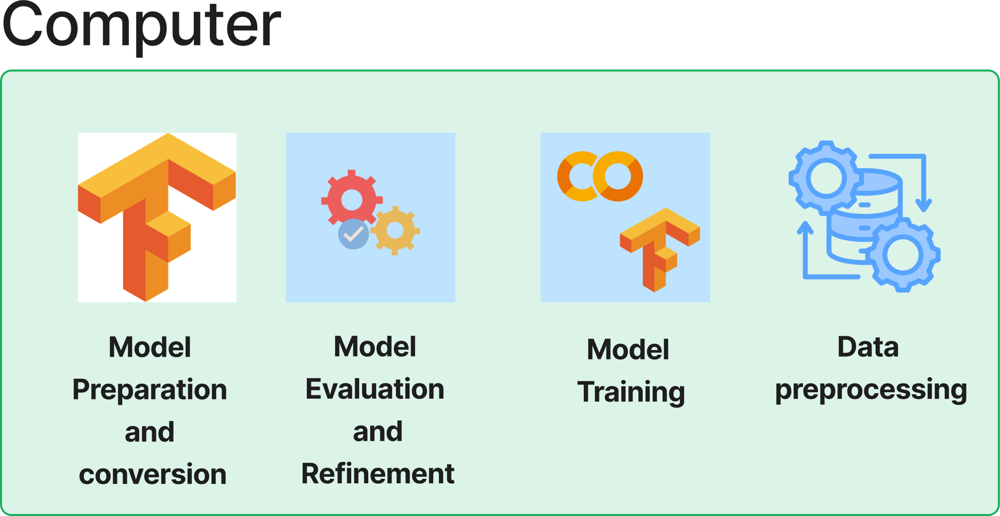</p>

Models are built on a computer in four stages: data preprocessing, model training, model evaluation and refinement, and conversion to TensorFlow Lite for the app.

In the current code, the eye-state model runs on a Flask server (port 8080). The sensor server (port 5000) only logs readings, and yawn detection is not deployed (see [Limitations](#limitations-and-future-work)).

## Repository structure

```
Dataset/
  Images Dataset/images dataset.zip        Eye-state and yawning images (Kaggle-sourced)
  Sensor Dataset/                          train_motion_data.csv, test_motion_data.csv
FYP Code/
  app + server/
    App/fyp/                               Flutter app (AlertEye)
    Server/
      eye_detection_server/                Flask server + MobileNet TFLite model
      sensor_detection_server/             Flask sensor-logging server + ConvLSTM2D TFLite model
      yawn_detection_server/               Placeholder (empty, see Limitations)
  Training and testing/
    CNN - MobileNet Training and Testing/  Eye and yawn notebooks (CNN and MobileNet), weights
    Sensors model training and testing/    Model_Testing.ipynb, conv_lstm_model.tflite, Training.zip
Poster/poster.pdf
Presentation/Final Presenation.pptx
Report/report.pdf                          Full project report
```

## Models and results

| Task | Model | Notes |
|---|---|---|
| Eye state (open / closed) | MobileNetV2 (ImageNet-pretrained, frozen base) + GlobalAveragePooling2D + Dropout 0.5 + Dense(1, sigmoid) | Adam, binary cross-entropy. **98% accuracy**. A custom CNN was also trained and performed worse. |
| Yawning | MobileNetV2 (same head) | **75% accuracy**. Trained, but not deployed in the app. |
| Driving behavior | ConvLSTM2D (32 filters, kernel (1,3), ReLU) + Dropout 0.3 + Dense(128) + Dense(2, softmax) | Input `(4, 1, 10, 6)` = 6 channels (AccX/Y/Z, GyroX/Y/Z). Adam, lr 0.001. Normal vs Aggressive; "Slow" was dropped. |

For the sensor task we also compared Random Forest, XGBoost, a Dense NN, LSTM and CNN-LSTM. ConvLSTM2D gave the best results (see `Training.zip`). Full details are in the [report](Report/report.pdf).

## Tech stack

- **App:** Flutter / Dart. Key packages: `camera`, `google_ml_kit`, `sensors_plus`, `tflite_flutter`, `just_audio`, `http`, `image`, `permission_handler`, `shared_preferences`, `fl_chart`.
- **Backend:** Python, Flask, TensorFlow Lite, OpenCV, NumPy, pandas.
- **Training:** TensorFlow/Keras in Jupyter notebooks.

## Getting started

### 1. Run the servers

The servers are Jupyter notebooks (`server.ipynb`). Install the dependencies and run them on the same Wi-Fi network as the phone:

```bash
pip install flask tensorflow opencv-python numpy pandas werkzeug
```

- **Eye server:** open `FYP Code/app + server/Server/eye_detection_server/server.ipynb` and run all cells. It listens on port **8080**. Health check: `GET /status`.
- **Sensor server:** open `FYP Code/app + server/Server/sensor_detection_server/server.ipynb` and run all cells. It listens on port **5000** and appends readings to `sensor_data.csv`.

### 2. Point the app at your server

The server IP is hardcoded. Replace `192.168.18.217` with your computer's LAN IP in:

- `FYP Code/app + server/App/fyp/lib/ui/local_processor.dart` (eye server, port 8080)
- `FYP Code/app + server/App/fyp/lib/ui/sensor_inference.dart` (sensor server, port 5000)

### 3. Run the app

Requires Flutter (Dart SDK `^3.5.3`) and a physical Android device, since the app uses the camera and motion sensors.

```bash
cd "FYP Code/app + server/App/fyp"
flutter pub get
flutter run
```

Grant the camera permission when prompted. Mount the phone so the driver's face is clearly visible, in good lighting.

## Server API

| Endpoint | Method | Body | Response |
|---|---|---|---|
| `/status` | GET | none | `{"status": "Server is running"}` |
| `/upload_eye_images` | POST (multipart) | `leftEye`, `rightEye` JPEG files | `leftEyeStatus` and `rightEyeStatus`, each `"eye open"` or `"eye closed"` |
| `/upload-sensor-data` | POST (JSON) | `{"gyro": [...], "acc": [...]}` with timestamps (`hh:mm:ss.mmm`) | 200 on success, 400 on missing or mismatched data |

## Datasets

- **Images:** `drowsiness_dataset` with `eye_state_detection` and `yawning_detection` splits (about 2,900 files in total), sourced from Kaggle and other public datasets.
- **Sensors:** self-collected phone accelerometer and gyroscope readings labelled `NORMAL`, `AGGRESSIVE` and `SLOW`. Columns: `AccX, AccY, AccZ, GyroX, GyroY, GyroZ, Class, Timestamp`. About 3.6k training rows and 3.1k test rows.

## Limitations and future work

- Yawn detection was trained, but `yawn_detection_server/` is empty and the app does not use it.
- The sensor server currently logs data only. Live ConvLSTM2D inference was validated offline in `Model_Testing.ipynb` and is not wired into the app.
- Server addresses are hardcoded, and the servers run as notebooks.
- Low-light conditions and limited dataset diversity reduce accuracy.
- Future work: model quantization and pruning, head-tilt and blink-pattern detection, finer driving-event classes (sudden braking, sharp turns), vehicle integration, and wider field testing.

## Documentation

- [Project report](Report/report.pdf)
- [Poster](Poster/poster.pdf)
- [Final presentation](Presentation/Final%20Presenation.pptx)

## Acknowledgements

We thank our supervisor, Dr. Hafeez Anwar, along with the faculty and peers at FAST-NUCES Peshawar who supported this project.

## License

This project is released under the [MIT License](LICENSE).
